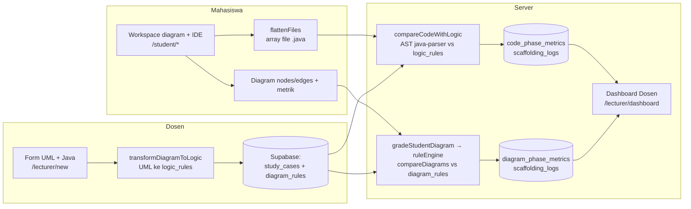

# Pathwise — Arsitektur & Peta Dokumentasi

> **Mulai dari sini.** Dokumen ini adalah pintu masuk untuk programmer yang baru
> membuka repo ini. Dokumentasi lain ada di folder `docs/`, masing-masing satu
> modul kecil yang saling terhubung.

## Apa ini?

**Pathwise** adalah platform pembelajaran OOP (Java) untuk mahasiswa dengan dua
kemampuan inti:

1. **Dosen** membuat *study case*: diagram UML kunci jawaban + file Java starter,
   yang diubah otomatis menjadi aturan penilaian (logic rules).
2. **Mahasiswa** mengerjakan study case tersebut: menggambar diagram UML lalu
   menulis kode Java. Karya mereka **dinilai otomatis** terhadap kunci jawaban
   dosen — bukan dikompilasi/dieksekusi.

Mahasiswa dibagi dua kelompok eksperimen (A/B testing): **EXPERIMENTAL**
(dapat scaffolding adaptif — hint bertahap) dan **CONTROL** (tanpa scaffolding).

## Stack

| Bagian | Teknologi | Lokasi |
|---|---|---|
| Client | Next.js 16 (App Router, "use client"), React, Tailwind, Monaco Editor, reactflow | `packages/client` |
| Server | Express 5, Node 22 (ESM), `java-parser` (AST), Supabase JS | `packages/server` |
| Database | Supabase (Postgres, diakses via REST) | — |
| Konfigurasi | Satu file `.env` di **root monorepo** | `.env` / `.env.example` |

## Peta folder

```
packages/server/src/
├── app.js                     # Entry point. Mount semua route (lihat modules/api.md)
├── config/
│   ├── env.js                 # Loader .env root (lihat modules/env.md)
│   └── supabase.js            # Client Supabase server-side
├── api/
│   ├── routes/                # authRoutes, studyCaseRoutes, graderRules,
│   │                          # lecturerDashboardRoutes, healthRoutes
│   ├── controllers/           # Logika per endpoint
│   └── middleware/            # authenticateToken (JWT), authorizeRole (role)
├── core/
│   ├── ast-parser/java-analyzer.js   # compareCodeWithLogic — inti grading kode
│   ├── grader/                       # graderService + ruleEngine — inti grading diagram
│   └── scaffolding/                  # Engine hint bertahap L1/L2/L3 (eksperimen)
└── services/transformerService.js    # transformDiagramToLogic (UML → logic rules)

packages/client/src/
├── app/                       # Halaman (peta lengkap: modules/client-pages.md)
├── components/                # JavaEditor (Monaco), ProjectExplorer, diagram/*
├── hooks/                     # useWorkspace (file tree), useDiagram, dll.
└── lib/                       # api.tsx (semua panggilan REST), supabase.tsx (browser)
```

## Keputusan arsitektur yang sudah final (jangan dibuat ulang)

- **Tidak ada compile/eksekusi kode.** Fitur run Java via Docker + WebSocket +
  queue (BullMQ/Redis) **sudah dihapus** karena produk menilai *kesesuaian kode
  dengan kunci UML*, bukan menjalankan kode. Folder `ws/`, `core/compiler/`,
  `queue/`, `workers/` memang tidak ada lagi. Dependensinya (`ws`, `bullmq`,
  `ioredis`) juga sudah dilepas dari `package.json`.
- **Tidak ada autentikasi Supabase bawaan.** Login memakai JWT buatan sendiri
  (`jsonwebtoken`) terhadap tabel `profiles` (lihat `modules/auth.md`).
- **Satu `.env` di root** untuk server + client (lihat `modules/env.md`).
- **Ground truth grading berada di DB** (`diagram_rules`, hasil transform UML
  dosen), meskipun saat ini client masih mengirim `logic_rules` — statusnya
  dicatat di `business-rules.md`.
- **Health check** `/health` (liveness) dan `/ready` (readiness) di-mount di
  root tanpa auth, konvensi untuk orchestrator.

## Diagram besar (sistem)



Alur detail per modul ada di `data-flow.md`.

## Indeks dokumentasi

| File | Isi |
|---|---|
| `docs/business-rules.md` | Aturan bisnis aktif vs yang belum di-enforce |
| `docs/data-flow.md` | Ilustrasi alur data (grading, dashboard, scaffolding) |
| `docs/modules/grading.md` | Mesin penilaian kode & diagram, metrik kognitif |
| `docs/modules/api.md` | Semua endpoint REST + payload/response |
| `docs/modules/auth.md` | JWT, role, dan utang keamanan yang diketahui |
| `docs/modules/env.md` | Konfigurasi env monorepo |
| `docs/modules/study-case.md` | Struktur study case & alur dosen |
| `docs/modules/client-pages.md` | Peta halaman client & navigasi |

## Menjalankan project

```bash
npm install          # sekali, di root (workspaces terurus otomatis)
cp .env.example .env # lalu isi nilainya (lihat docs/modules/env.md)
npm run dev          # client di :3000, server di :4000
```

Verifikasi server siap: `curl http://localhost:4000/ready` harus balik `200
status: "ready"`.
