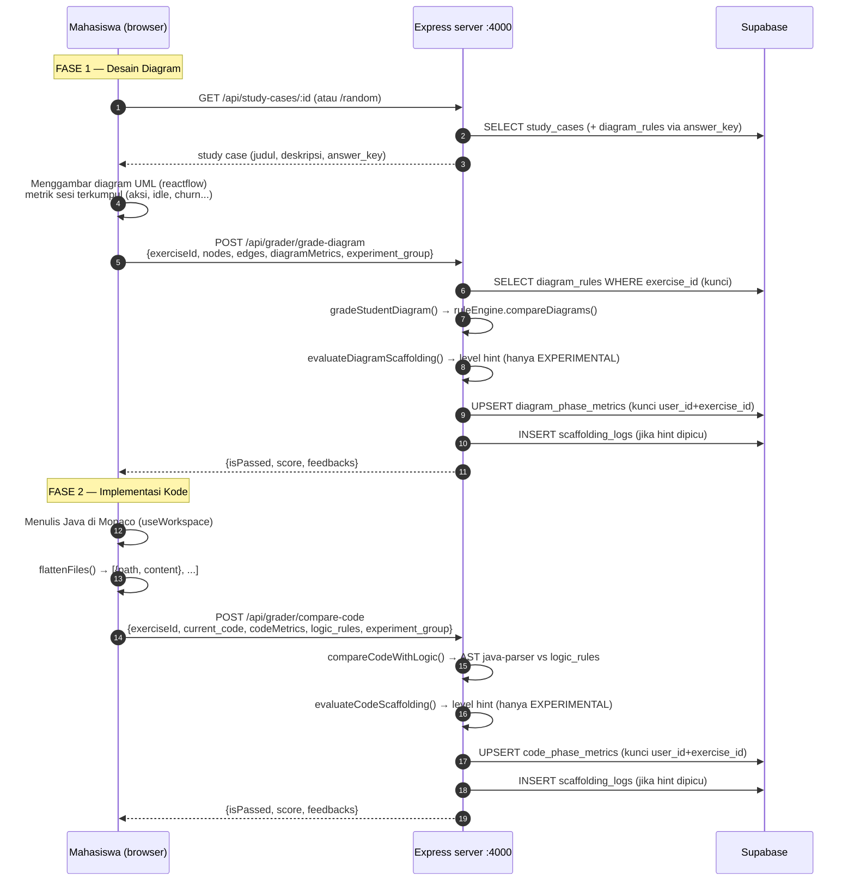
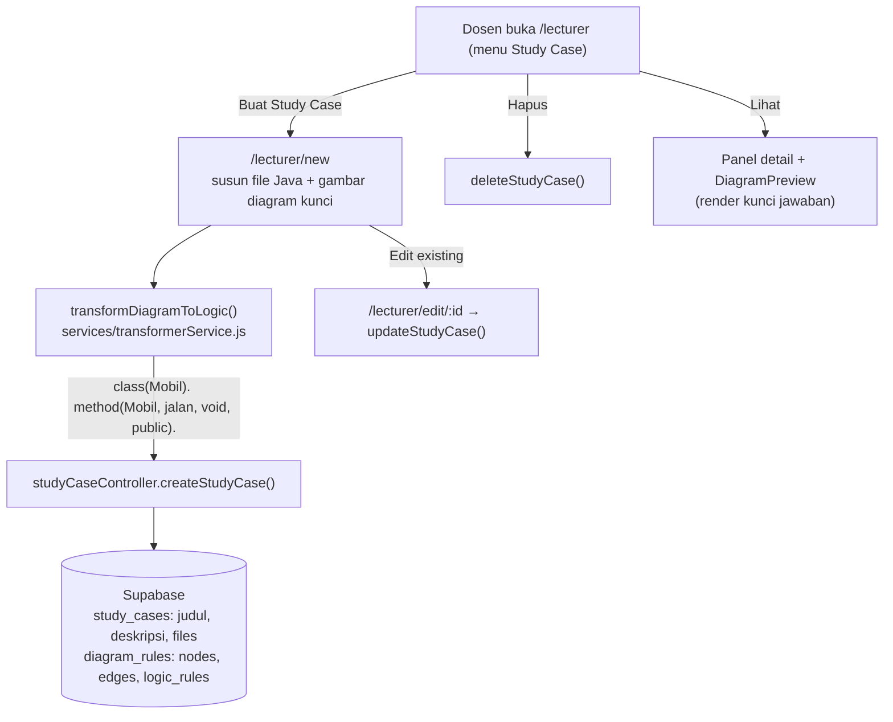
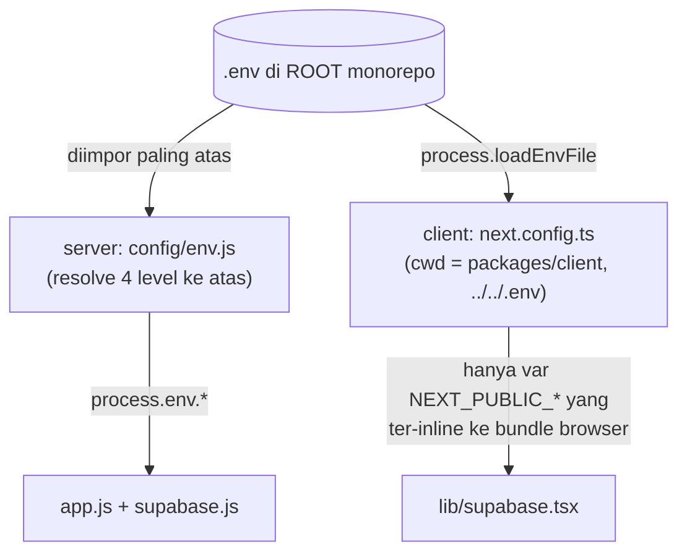
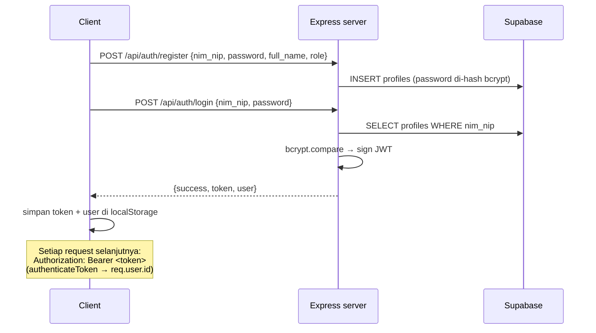

# Alur Data Pathwise

> Ilustrasi alur data yang berjalan saat ini. Nama fungsi di bawah adalah nama
> persis di kode. Aturan bisnis yang mendasar tiap alur ada di
> `docs/business-rules.md` (dirujuk sebagai BR-x).

## 1. Alur pengerjaan mahasiswa (alur utama)

Satu study case, dua fase berurutan: **desain diagram** → **implementasi kode**.



Poin penting di alur ini:
- `user_id` **selalu** dari JWT (BR-9); `exerciseId`/`logic_rules` datang dari
  client (status terbuka: BR-8, BR-11).
- Fase 2 bisa diulang beberapa kali submit; tiap submit **menimpa** baris
  metrik yang sama, bukan membuat baris baru (BR-10).
- `scaffolding_logs` bersifat **append-only** — riwayat intervensi, tidak pernah
  ditimpa.

## 2. Alur dosen membuat study case



Semua CRUD study case dikelola dari **satu menu Study Case** di sidebar dosen
(lihat `modules/client-pages.md`).

## 3. Alur data dashboard dosen

```mermaid
flowchart LR
    subgraph Server["lecturerDashboardController.getLecturerDashboardData()"]
        Q1["SELECT profiles<br/>role = student"] --> AG
        Q2["SELECT diagram_phase_metrics"] --> AG
        Q3["SELECT code_phase_metrics"] --> AG
        Q4["SELECT scaffolding_logs"] --> AG
        AG["Agregasi in-memory:<br/>dedup exercise via Set;<br/>bentuk array student.exercises"]
    end
    subgraph DB[("Supabase")]
        T1[(profiles)]
        T2[(diagram_phase_metrics)]
        T3[(code_phase_metrics)]
        T4[(scaffolding_logs)]
    end
    T1 --> Q1
    T2 --> Q2
    T3 --> Q3
    T4 --> Q4
    AG --> UI["GET /api/lecturer/dashboard/data<br/>Dashboard :4000 tabel mahasiswa + panel detail"]
```

Agregasi yang dilakukan server (dipahami client apa adanya):
- `attemptedExerciseIds` di-dedup via `Set` — satu exercise selalu muncul
  sekali per mahasiswa meski ada banyak log.
- `latestScore` diambil dari `scaffolding_logs` terbaru per exercise — yaitu
  **skor saat log terakhir**, bukan skor terbaik (perilaku aktif, bukan bug).
- `experiment_group` student diambil dari baris metrik pertama yang ditemukan.

## 4. Alur env (konfigurasi)



Detail key & aturan: `modules/env.md`.

## 5. Alur autentikasi



Detail + utang keamanan yang diketahui: `modules/auth.md`.
